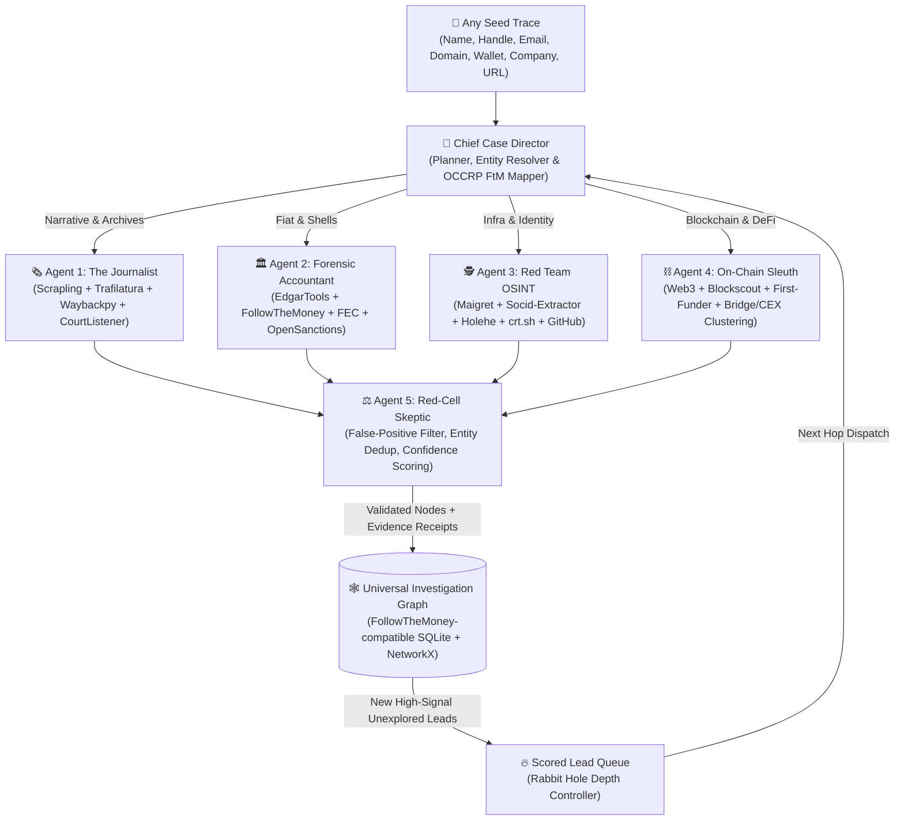

# Bunnyhole: Autonomous Multi-Domain Investigative AI Architecture

> **Vision:** An autonomous investigative engine that chases leads down the rabbit hole across **news narratives**, **corporate/fiat filings**, **infrastructure OSINT**, and **on-chain forensics**—mapping every discovery onto a provenance-backed, interactive **Investigation Graph**.

---

## 1. Core Paradigm: The "Lead-Pivot-Prove" Engine

Most AI research tools do shallow RAG: they run 3 web searches and summarize the top results. Real investigators—whether investigative journalists (OCCRP, Bellingcat), FBI forensic accountants, red teamers, or on-chain sleuths (ZachXBT)—operate on **cross-domain pivots and immutable receipts**:

1. **Seed Extraction:** Start with *any* trace: a person's name, an email, a username/handle, a phone number, a company, a domain (`example.com`), a crypto wallet (`0x...`), a token contract, or a breaking news URL.
2. **Cross-Domain Pivoting:** A news article mentions a company $\rightarrow$ `edgartools` pulls SEC Form D / Exhibit 21 revealing an unlisted subsidiary and an executive's address $\rightarrow$ FEC campaign finance logs link that executive to a secondary LLC $\rightarrow$ `crt.sh` and Scrapling-powered stealth scraping on the LLC's domain leak a developer handle and Google Analytics tag $\rightarrow$ `maigret` & `socid-extractor` link that handle to an ENS name and a seed wallet that funded an insider token launch.
3. **Receipts-Only Graph (Zero Hallucination Policy):** An agent cannot add a node or edge to the Bunnyhole graph without attaching an immutable **Evidence Receipt** (exact API response snippet, SHA-256 hash of scraped DOM, SEC filing accession number, tx hash, DNS record, or Wayback snapshot URL).



---

## 2. The Open-Source Arsenal (Repos & Engines Powering Bunnyhole)

Instead of reinventing scrapers and parsers from scratch, Bunnyhole wraps the sharpest open-source investigative, OSINT, and forensic libraries in the Python ecosystem into unified **Agent Tools**:

### 🕷️ Layer 1: Adaptive Stealth Scraping & Evidence Archival
| Repository / Library | What It Does | How Bunnyhole Uses It |
| :--- | :--- | :--- |
| **`D4Vinci/Scrapling`** | High-performance adaptive scraper with **`Fetcher`**, **`DynamicFetcher`**, and **`StealthyFetcher`** (bypasses Cloudflare Turnstile, TLS/canvas fingerprint spoofing, and **self-healing CSS/XPath selectors** when layouts change). | Our primary web extraction weapon. When an agent hits a Cloudflare-protected corporate registry, block explorer, forum, or news site, `StealthyFetcher` renders JS under the radar and saves adaptive selectors so recurring monitors never break. |
| **`adbar/trafilatura`** | State-of-the-art article & metadata extractor that strips boilerplate, ads, and navbars while preserving author, publish date, comments, and clean Markdown text. | Paired with `Scrapling`: Scrapling fetches the raw protected DOM, and `trafilatura` extracts clean journalistic text, author bylines, and publication dates for timeline construction. |
| **`akamhy/waybackpy`** + **CDX API** | Python interface to the Internet Archive's Save, Availability, and CDX Server APIs. | **1) Auto-Preservation:** Automatically snapshots live evidence URLs before targets delete them (inspired by **`bellingcat/auto-archiver`**).<br>**2) Ghost Hunting:** Pulls historical snapshots of `/team`, `/about`, or docs pages to catch scrubbed founders or silent edits. |

### 🕵️ Layer 2: Identity, Handle, Email & Infrastructure OSINT
| Repository / Library | What It Does | How Bunnyhole Uses It |
| :--- | :--- | :--- |
| **`soxoj/maigret`** & **`soxoj/socid-extractor`** | Next-gen evolution of `sherlock`. Instead of just checking if a username exists across 2,500+ sites, `socid-extractor` parses the profile HTML/JSON to extract **full names, bios, avatars, UIDs, linked URLs, and secondary handles** without API keys. | When Bunnyhole finds a single handle (e.g., from a GitHub commit, Telegram bio, or ENS record), it pivots across platforms and automatically extracts new leads from profile metadata. |
| **`megadose/holehe`** & **`megadose/ignorant`** | Checks whether an **email** (`holehe`, 120+ sites) or **phone number** (`ignorant`) is registered on platforms (Twitter/X, Instagram, Spotify, GitHub, Gravatar, etc.) via non-intrusive registration/recovery checks without alerting the target. | Turns a leaked email (from WHOIS, GitHub `.patch`, or FEC filing) into a verified map of active accounts. |
| **GitHub `.patch` & Octosuite Methods** | Appending `.patch` to any GitHub commit URL reveals the raw git commit header (`From: Real Name <personal@email.com>`) even when the web UI hides it. | Connects pseudonymous developers and smart-contract deployers to real emails, PGP keys, and timezones (via commit timestamp distributions). |
| **Infra & Fingerprint Recon (`crt.sh`, `dnstwist`, `mmh3`)** | Certificate Transparency logs, DNS/RDAP history, favicon MurmurHash (`mmh3` for Shodan/Censys matching), and DOM regex for Google Analytics (`G-`/`UA-`), AdSense (`pub-`), and embedded wallet addresses. | Proves that two "unrelated" websites or anon crypto frontends are operated by the same person/company because they share a TLS SAN cert, GA tag, or favicon hash. |

### 🏛️ Layer 3: Corporate Veils, Regulatory Filings & Fiat Trails
| Repository / Library | What It Does | How Bunnyhole Uses It |
| :--- | :--- | :--- |
| **`dgunning/edgartools`** | Keyless Python library for SEC EDGAR that parses XBRL and filings (`10-K`, `10-Q`, `8-K`, `DEF 14A` proxy statements, **`Form 4`** insider trades, **`Form D`** private VC/crypto raises, **`13D/13G`** activist ownership, and **`Exhibit 21`** subsidiaries) into clean Python objects/DataFrames. | Gives Agent 2 instant FBI-grade visibility into U.S. public companies, private startup raises (Form D lists executive names & addresses!), and insider stock dumps around key news dates. |
| **`alephdata/followthemoney` (OCCRP)** | The flagship investigative journalism ontology and entity-resolution toolkit created by **OCCRP (Organized Crime and Corruption Reporting Project)** for the Aleph platform. Models `Person`, `Company`, `LegalEntity`, `Ownership`, `Directorship`, `Payment`, `CourtCase`, `CryptoWallet`. | We align Bunnyhole's **Universal Investigation Graph** with OCCRP's `FollowTheMoney` concepts—including transliteration and fuzzy entity resolution—so Bunnyhole graphs can even export to OCCRP Aleph / Gephi / Neo4j. |
| **OpenSanctions / OFAC + FEC + ProPublica 990 + CourtListener** | Public APIs for sanctions/PEPs, U.S. political donations (which expose employer & residential city/zip), IRS Form 990 non-profit filings (foundation grants & executive pay), and federal court dockets (RECAP). | Cross-references every person and LLC discovered during an investigation against federal lawsuits, political donations, tax-exempt foundations, and global watchlists. |

### ⛓️ Layer 4: On-Chain & Cross-Chain Crypto Forensics
| Method / Library | What It Does | How Bunnyhole Uses It |
| :--- | :--- | :--- |
| **ZachXBT & `chainforensics` Playbook** | Heuristics for **First-Funder ("Mother Wallet") gas tracing**, **CEX Deposit Sweep Clustering**, **Common Input Ownership (BTC UTXO)**, **Peeling Chain detection**, and **Timing + Amount Cross-Chain Bridge correlation**. | Implemented in Agent 4 using async `web3.py`, **Blockscout REST API v2** (keyless multi-chain EVM logs, internal txs, ERC-20 transfers), **Mempool.space API** (Bitcoin), **Solana RPC**, **DexScreener**, and **DeFiLlama**. |

---

## 3. Investigative Methods: How Bunnyhole Follows Any Trace

Here are the **4 core investigative workflows** engineered into Bunnyhole's orchestrator:

### Method A: Unmasking an Anon Actor or Scammer ("The ZachXBT $\times$ Bellingcat Pivot")
1. **Start:** A suspicious smart contract or wallet address (`0xabc...`), or an anonymous project domain (`shadowswap.fi`).
2. **On-Chain Hop:** Agent 4 traces `0xabc...` backward to its **first gas funder** (`0x111...`). It inspects all other wallets funded by `0x111...` and finds one that interacted with an **ENS name** (`devvault.eth`) or deposited into a fixed **Binance deposit address** shared by a doxxed wallet.
3. **Infra Hop:** Simultaneously, Agent 3 uses **`Scrapling` (`StealthyFetcher`)** to pull `shadowswap.fi` and its historical snapshots via **`waybackpy`**. It extracts the sourcemaps, hidden `.git` config, Google Analytics ID, and queries `crt.sh` for sister domains.
4. **Identity Hop:** A sister domain or GitHub repo commit (`.patch`) exposes handle `krypto_builder99` and email `kb99@domain.com`. **`maigret` + `socid-extractor`** and **`holehe`** pivot that handle/email into a real name and location.
5. **Fiat Hop:** Agent 2 runs the real name + location through **SEC Form D**, **FEC donations**, and **CourtListener**, uncovering the Delaware/Wyoming LLC behind the operation.

### Method B: Following Corporate Money & Piercing Shell Networks ("The OCCRP / Forensic Accountant Loop")
1. **Start:** A company name, executive name, or government contract recipient.
2. **Corporate Tree:** Agent 2 uses **`edgartools`** to pull SEC filings (`Exhibit 21` subsidiaries, `DEF 14A` executive compensation & related-party transactions, `Form D` private offerings) and **ProPublica Form 990s** (if a foundation/nonprofit is involved).
3. **Address & Officer Pivoting:** Extracts officer names and physical addresses. The **Red-Cell Skeptic (Agent 5)** automatically filters out known registered agent addresses (e.g., *251 Little Falls Dr, Wilmington DE* or *Corporation Trust Center*) so the graph only links genuine shared operational offices.
4. **Litigation & Political Trail:** Queries **FEC** (matching person + employer/address) and **CourtListener RECAP** to find lawsuits, bankruptcies, or whistleblowers mentioning the target.

### Method C: Fueling a Breaking Story ("The Journalist's Contradiction Engine")
1. **Start:** A breaking news URL, press release, or rumor.
2. **Claim & Entity Extraction:** Agent 1 uses **`Scrapling` + `trafilatura`** to extract all named entities (`Person`, `Organization`, `Wallet`, `Date`, `Claim`) and builds a **Master Chronological Timeline**.
3. **The "Who Knew What When" Overlay:** Bunnyhole automatically plots **SEC Form 4 insider stock sales** (via `edgartools`), **on-chain whale/treasury transfers** (via Agent 4), and **website/terms-of-service edits** (via `waybackpy` diffing) onto the exact same timeline as the public news statements—instantly highlighting suspicious activity right before or after an announcement.

---

## 4. Universal Investigation Graph Schema (OCCRP FtM Compatible)

Every node and edge is stored locally in SQLite + NetworkX (and exportable to JSON/GraphML/Markdown Dossiers), backed by mandatory **Evidence Receipts**:

```json
{
  "id": "edge_9021a",
  "source_id": "domain:shadowswap.fi",
  "target_id": "account:github:krypto_builder99",
  "relation": "OPERATED_BY",
  "confidence": 0.92,
  "status": "VERIFIED",
  "discovered_by": "osint_agent",
  "receipts": [
    {
      "tool": "scrapling_stealthy + waybackpy",
      "source_url": "https://web.archive.org/web/20251102/https://shadowswap.fi/static/js/main.js.map",
      "extracted_fact": "Archived JS sourcemap references local path /Users/krypto_builder99/repos/shadowswap-ui/",
      "sha256_proof": "9f86d081884c7d659a2feaa0c55ad015a3bf4f1b2b0b822cd15d6c15b0f00a08"
    }
  ]
}
```

---

## 5. Implementation Roadmap (Ready to Build)

1. **Core Python Engine (`bunnyhole/core`):**
   * Universal Graph + Receipt Store (`SQLite` + `NetworkX` + OCCRP `FollowTheMoney`-style entity resolution).
   * **Adaptive Scraper & Archiver Service:** Built on **`Scrapling`** + **`trafilatura`** + **`waybackpy`**.
   * **The 5 Autonomous Agents:**
     * `JournalistAgent` (News RSS/GDELT, Scrapling + Trafilatura article parser, Wayback CDX diffing, CourtListener dockets).
     * `AccountantAgent` (`edgartools` SEC Form D/4/10-K/13D, FEC API, ProPublica 990s, USAspending, OpenSanctions/OFAC).
     * `OSINTAgent` (`crt.sh`, DNS/RDAP, GitHub `.patch` email extractor, `maigret`/`socid-extractor` profile parser, `holehe` email checker, GA/AdSense/favicon fingerprint correlator).
     * `OnChainAgent` (Blockscout multi-chain EVM, First-Funder gas tracer, CEX deposit sweep detector, DexScreener token forensics, Bitcoin Mempool.space, Solana RPC).
     * `SkepticAgent` (Registered-agent & Cloudflare false-positive filter, confidence scorer, "Smoke Index" lead ranker).
2. **CLI Tool (`bunnyhole`):**
   * Rich terminal interface: `bunnyhole trace <seed> --depth 3` (streams live agent pivots, outputs a verified Markdown dossier + graph JSON).
3. **Interactive Web War-Room (`bunnyhole/web`):**
   * FastAPI + SSE streaming backend connected to a dark-mode **Next.js + React Flow** investigation canvas with click-to-pivot context menus, an Evidence Receipt drawer, and a synchronized cross-domain Timeline bar.
