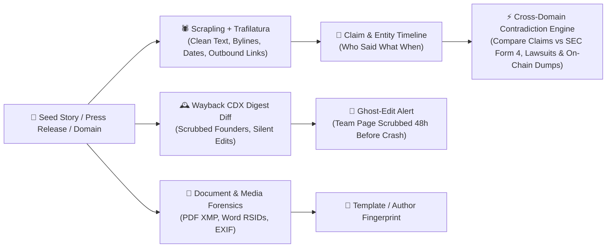
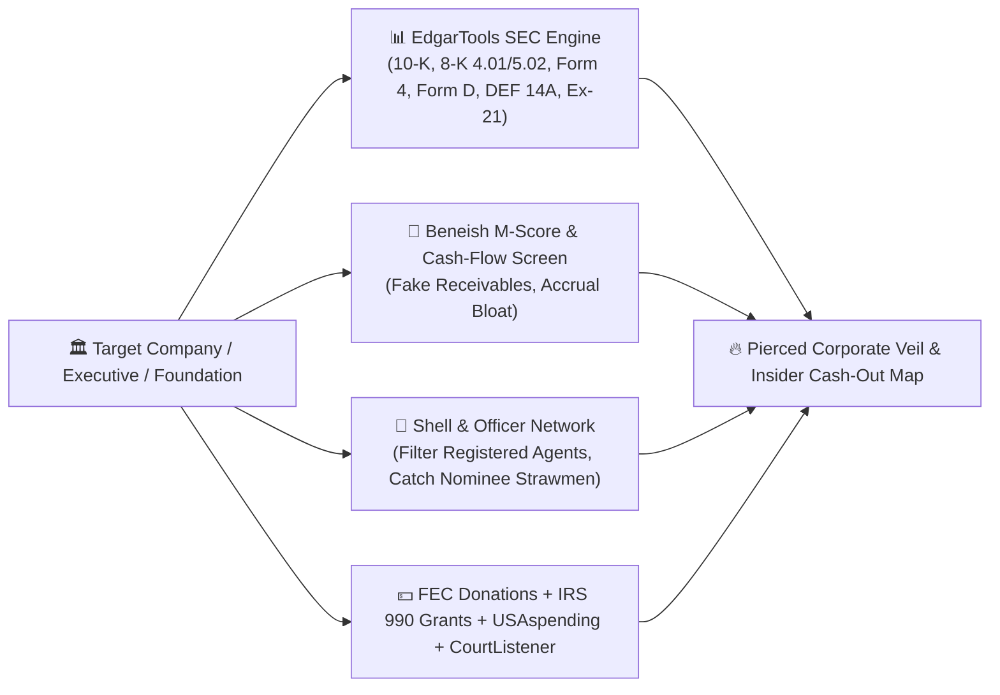
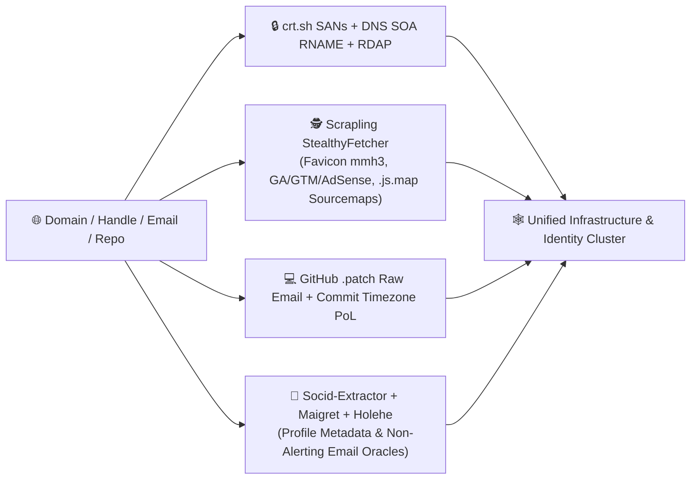
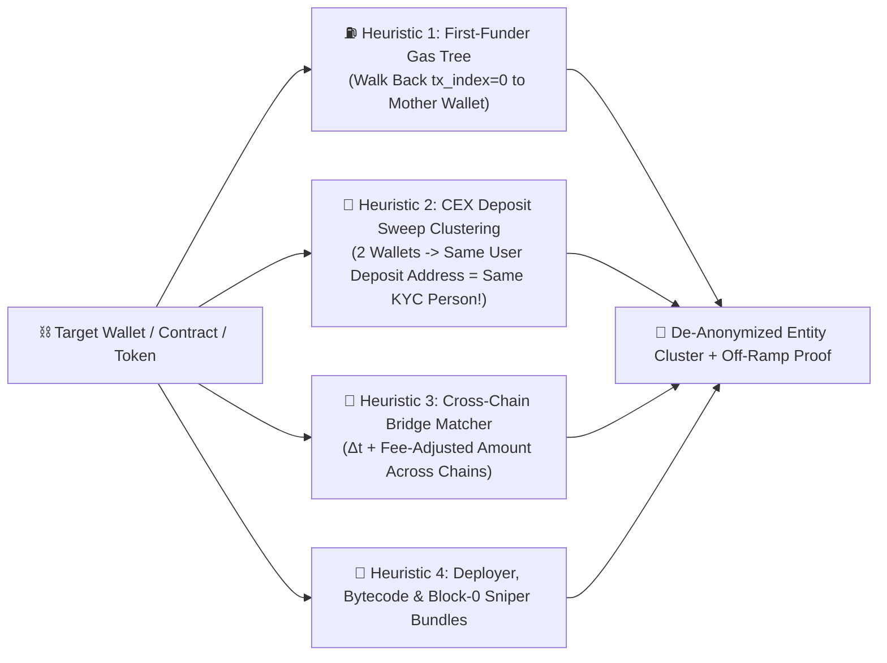

# 🐇🕳️ Bunnyhole: Exhaustive Tradecraft & Intelligence Doctrine

> **Purpose of this Document:** Before building the full Bunnyhole engine, this dossier codifies the **exact tradecraft, mathematical heuristics, forensic equations, and pivoting playbooks** used by intelligence agencies (CIA, NSA, NGA, DIA), investigative journalism consortia (ICIJ, OCCRP, Bellingcat), forensic short-sellers & FBI/FinCEN investigators (Hindenburg Research, Muddy Waters), APT threat hunters (Mandiant), and on-chain sleuths (ZachXBT, TRM Labs, Chainalysis).

---

## Pillar 0: Spy Agency Analytic Doctrine (The Brain of Bunnyhole)

What separates a world-class intelligence system (like Palantir Gotham or NSA/NGA fusion cells) from a noisy web scraper is **Structured Analytic Tradecraft**. Bunnyhole's orchestrator and Red-Cell Skeptic enforce four foundational intelligence frameworks:

### 0.1 Activity-Based Intelligence (ABI) — NGA / DIA Doctrine
Developed by the National Geospatial-Intelligence Agency (NGA) and Defense Intelligence Agency (DIA) to hunt elusive networks, **ABI** replaces linear "target-first" searching with four laws:
1. **Data Neutrality:** Every piece of data—whether an SEC Form 4 stock dump, a 3:14 AM git commit, a 0.02 ETH gas transfer, or a deleted `/team` web page—is indexed identically as a **Spatio-Temporal Event** $(t, \text{location/network}, \text{actor}, \text{action})$.
2. **Geotemporal / Chronological Multi-INT Fusion:** Single-domain clues look innocent in isolation. ABI fuses all four domains onto a single time axis so the engine spots **Cross-Domain Coincidences** (e.g., *Company registers a Delaware LLC on Tuesday $\rightarrow$ Developer pushes contract to GitHub on Wednesday $\rightarrow$ Fresh wallet funded via bridge deploys contract on Thursday $\rightarrow$ Press release drops on Friday*).
3. **"Sequence to Neutrality" (Proxy Unmasking):** Bad actors use high-OpSec proxies (burner wallets, offshore shells, Cloudflare fronts) during the "crime" or main event. However, **no actor maintains perfect OpSec 100% of the time**. ABI traces a proxy *backward to creation* (how was the domain paid for? who sent the first $5 of ETH gas?) and *forward to liquidation* (where did the cash-out sweep land?) until the proxy crosses a **High-Friction Identity Boundary** (KYC exchange, SEC filing, personal email, home timezone).
4. **Incidental Collection & Peripheral Indexing:** When expanding hop $N$, Bunnyhole stores "incidental" background nodes (co-signers, shared tracking tags, secondary subdomains, counterparty wallets) in a **Dormant Peripheral Index** without immediately burning API quota chasing them. If *another* branch of the investigation independently hits that same peripheral node from a different angle (**Path Convergence**), its priority score spikes to `95+` and Bunnyhole immediately dispatches a deep sweep.

### 0.2 NSA Contact Chaining & Selector Taxonomy
In SIGINT and link analysis, every pivot point is classified as a **Selector**:

| Selector Class | Definition | Examples Across Bunnyhole's 4 Domains | Chaining Rule |
| :--- | :--- | :--- | :--- |
| **Strong Selector (Deterministic)** | Globally unique identifier with near-zero collision rate. | • Crypto wallet / contract (`0x...`) • SEC CIK / IRS EIN / LEI • Email address / Phone number • GitHub UID / TLS Cert SHA-256 • Google Analytics (`G-XXXX`) / AdSense (`pub-XXXX`) • Word Document `RSID` hex tag | **Safe for multi-hop chaining** ($\text{Strong} \rightarrow \text{Strong} \rightarrow \text{Strong}$ up to depth $N$). |
| **Soft Selector (Probabilistic)** | Shared or ambiguous attribute prone to false-positive collisions ("Ripple Effect"). | • Human name (*"Michael Chen"*) • Shared Cloudflare/AWS IP (`104.21.x.x`) • Commercial Registered Agent (*251 Little Falls Dr, Wilmington DE*) • Commit Timezone (`UTC+3`) • Favicon `mmh3` hash of a generic framework icon | **NEVER chain $\text{Soft} \rightarrow \text{Soft}$ alone.** Requires **$\ge 2$ independent Soft Selectors intersecting** (e.g., *Same Name + Same City/Employer*, or *Same Timezone + Same Opcode Fingerprint*) to promote to a corroborated link. |

#### Graph Mathematics for Finding "Cut-Outs", "Brokers", and "Strawmen"
In criminal, corporate, and intelligence networks, the mastermind rarely has the highest **Degree Centrality** (most direct connections). Instead, they hide behind a **Cut-Out / Nominee / Broker**. Bunnyhole runs two continuous NetworkX algorithms on the investigation graph:
- **Betweenness Centrality** $C_B(v) = \sum_{s \neq v \neq t} \frac{\sigma_{st}(v)}{\sigma_{st}}$: Highlights nodes that act as the **sole bridge** connecting an offshore fiat shell cluster to an on-chain wallet cluster or an OSINT infrastructure cluster.
- **Bi-Connected Component / Articulation Point Detection:** Identifies the exact "linchpin" entity (an email, a shared dev, a single CEX deposit address, or a corporate secretary) whose removal would sever the connection between two worlds.

### 0.3 The NATO Admiralty System (`A1`–`F6`) & CIA Analysis of Competing Hypotheses (ACH)
Instead of a vague "confidence percentage," Bunnyhole grades every Evidence Receipt using the **NATO STANAG 2511 Admiralty Code**, separating **Source Reliability (`A`–`F`)** from **Information Credibility (`1`–`6`)**:

* **Source Reliability:**
  * `A` (Completely Reliable): Cryptographic blockchain state, official SEC EDGAR / Court docket / DNS root record.
  * `B` (Usually Reliable): Major archival records (Wayback Machine CDX, Certificate Transparency logs, FEC/IRS 990 databases).
  * `C` (Fairly Reliable): Mainstream investigative journalism, corporate press releases, GitHub API metadata.
  * `D` (Not Usually Reliable): Unverified forum posts, partisan "pink slime" sites, anonymous social bios.
  * `E` (Unreliable): Known disinformation/spoofed records (e.g., intentionally forged git commit author headers without GPG signature).
  * `F` (Cannot Be Judged): Newly discovered raw web pages or unindexed leaks.
* **Information Credibility:**
  * `1`: Confirmed by independent `A`/`B` sources across domains.
  * `2`: Probably true, logical, consistent with other facts.
  * `3`: Possibly true, plausible but uncorroborated.
  * `4`: Doubtful / conflicts with behavioral timeline.
  * `5`: Improbable / matches known false-positive trap (e.g., shared Registered Agent).
  * `6`: Truth cannot be judged yet.

#### CIA Analysis of Competing Hypotheses (ACH) Matrix
When Bunnyhole investigates a question (e.g., *"Are Entity X and Entity Y controlled by the same actor?"* or *"Is Company Z fabricating revenue?"*), the **Red-Cell Skeptic** constructs an **ACH Matrix** comparing:
- $H_1$ (**Attribution / Malfeasance Hypothesis**): They are controlled by the same operator / insider group.
- $H_2$ (**Coincidence / Shared Vendor Hypothesis**): They merely used the same dev agency, hosting provider, registered agent, or market maker.
- $H_3$ (**False Flag / Spoofing Hypothesis**): An attacker intentionally planted someone else's handle/ENS in git headers or transfer memos to frame them.

Evidence is weighted by **Diagnosticity**—a shared Cloudflare IP has near-zero diagnosticity (consistent with both $H_1$ and $H_2$), whereas two wallets sweeping into the *same Binance user deposit address* or two `.docx` files sharing the *same random Word RSID pool* has **extreme diagnosticity** (refutes $H_2$ completely).

---

## Part I Deep Dive: Investigative Journalism & Narrative Intelligence ("Follow the Story")

> **Modeled After:** Bellingcat, ICIJ (Panama/Pandora Papers), ProPublica, Columbia Journalism Review Tow Center.

### 1.1 The "Ghost-Edit" & Scrubbed History Engine (Wayback CDX Digest Diffing)
Targets routinely scrub their websites right before or after a crisis—deleting an advisor from `/about`, changing a tokenomics allocation table in `/docs`, or removing a parent company name from `/privacy`.
* **How Bunnyhole Does It:**
  1. Queries the Internet Archive CDX Server API:
     `http://web.archive.org/cdx/search/cdx?url=target.com/*&output=json&fl=timestamp,original,statuscode,digest,length&collapse=digest`
  2. By collapsing on `digest` (the SHA-1 hash of the page content), Bunnyhole immediately isolates the **exact dates when the page content changed**.
  3. Prioritizes high-value paths: `/about`, `/team`, `/leadership`, `/investors`, `/partners`, `/terms`, `/privacy`, `/legal`, `/whitepaper`, `/security`.
  4. Fetches the oldest snapshot, the pre-crisis snapshot, and the current live page (via **`Scrapling`** + **`trafilatura`**), diffs the extracted entities (`Person`, `Organization`, `Wallet`, `Address`), and flags any **Erased Entity** as a high-priority lead!

### 1.2 Narrative Laundering & "Pink Slime" Disinformation Detection
When a shady company, PR firm, or threat actor wants to manufacture consensus—or bury an investigation—they use **Narrative Laundering**:
1. **Placement:** A claim is planted on an obscure blog, Substack, Medium post, or PR wire.
2. **Layering (Syndication Cascade):** Dozens of algorithmic "pink slime" local news sites or paid crypto/finance blogs republish near-identical text within hours.
3. **Integration:** Mainstream aggregators or Wikipedia editors cite the "multiple news reports."
* **How Bunnyhole Detects It:**
  * **Chronological Origin ("Patient Zero") Search:** Sorts all news/GDELT/RSS mentions of a narrative or uncommon phrase by exact UTC publication timestamp to identify the **first publisher ($t_0$)**.
  * **Shingling & MinHash Copy-Pasta Score:** Computes 5-gram token Jaccard similarity across articles covering the target. If 8 "independent" outlets share $>65\%$ 5-gram overlap, Bunnyhole flags an **Undisclosed PR / Astroturf Syndicate**.
  * **Infra Cross-Check:** Dispatches Agent 3 (OSINT) on the domains publishing the narrative to check if they share Google AdSense (`pub-`), Google Analytics, Cloudflare nameserver pairs, or registrar patterns.

### 1.3 Digital Document Forensics (PDF XMP, Word `RSID` Fingerprints, EXIF)
Journalists rarely trust the visible text of a leaked PDF, whitepaper, or press release—they dissect the binary container:
* **Microsoft Word `RSID` (Revision Save ID) Tracking:**
  * `.docx` files are ZIP archives containing `word/document.xml` and `word/settings.xml`.
  * Every time a document is created (`rsidRoot`) or saved after an edit (`w:rsid`), Word generates a random 8-character hexadecimal identifier (e.g., `00A47F21`).
  * **The Forensic Breakthrough:** Even if an author strips their name from Document Properties or exports variants for two "unrelated" shell organizations, if both `.docx` files share `rsidRoot` or overlap on $\ge 3$ `w:rsid` tags in `settings.xml`, it is **mathematical proof ($p < 10^{-12}$)** that both documents originated from the **exact same base Word file**.
* **PDF `/Info` Dictionary & Adobe XMP Packet Forensics:**
  * Extracts `/Author`, `/Creator`, `/Producer`, `/CreationDate`, `/ModDate`, and raw XML `<x:xmpmeta>` packets (`xmpMM:DocumentID`, `xmpMM:InstanceID`).
  * **Timezone Leak:** PDF dates are stored in `D:YYYYMMDDHHmmSS+HH'mm'` format (e.g., `D:20261012142210+04'00'`). A PDF claiming to be published by a Delaware corporation in New York (`-04'00'`) whose `/CreationDate` carries `+04'00'` (Dubai/Moscow/Tbilisi) or `+08'00'` (Singapore/Beijing/HK) immediately exposes the author's local machine timezone.

### 1.4 The "Contradiction Engine" (Public Claims vs. Covert Actions)
Every public statement (`Event` / `Claim`) extracted from news or social media is automatically cross-examined against a $\pm 14\text{-day}$ window of hard regulatory and on-chain records:
* *"We have no exposure to [Collapsed Entity]"* $\leftrightarrow$ Cross-checked against bankruptcy creditor matrices, on-chain token approvals/transfers, and SEC 8-K filings.
* *"Insiders are committed for the long term"* $\leftrightarrow$ Cross-checked against **SEC Form 4** stock sales and **On-Chain Team/Treasury Wallet** transfers to Binance/Coinbase deposit addresses.

---

## Part II Deep Dive: Forensic Accounting, FBI/FinCEN FININT & Short-Seller Tradecraft ("Follow the Fiat")

> **Modeled After:** Hindenburg Research, Muddy Waters Research, FBI Forensic Accountants, FinCEN SAR Typologies, OCCRP Aleph.

### 2.1 Quantitative Fraud & Earnings Manipulation Math (The Beneish M-Score)
Before reading 300 pages of footnotes, forensic short-sellers run quantitative screens on XBRL financial statements (via **`edgartools`**) to detect earnings fabrication:

$$\text{M-Score} = -4.84 + 0.920(\text{DSRI}) + 0.528(\text{GMI}) + 0.404(\text{AQI}) + 0.892(\text{SGI}) + 0.115(\text{DEPI}) - 0.172(\text{SGAI}) + 4.679(\text{TATA}) - 0.327(\text{LVGI})$$

| Ratio | Formula / Meaning | What a Spike Proves |
| :--- | :--- | :--- |
| **DSRI** (Days Sales in Receivables Index) | $\frac{\text{Receivables}_t / \text{Sales}_t}{\text{Receivables}_{t-1} / \text{Sales}_{t-1}}$ | **Channel Stuffing / Fictitious Revenue:** The company is booking "sales" to related-party shells that never actually pay cash ($\text{DSRI} > 1.25$). |
| **AQI** (Asset Quality Index) | $\frac{1 - (\text{Current Assets}_t + \text{PP\&E}_t)/\text{Total Assets}_t}{1 - (\text{Current Assets}_{t-1} + \text{PP\&E}_{t-1})/\text{Total Assets}_{t-1}}$ | **Expense Capitalization:** Dumping routine operating costs into "Intangibles / Other Long-Term Assets" to inflate net income. |
| **TATA** (Total Accruals to Total Assets) | $\frac{\text{Net Income}_t - \text{Operating Cash Flow}_t}{\text{Total Assets}_t}$ | **Paper Profits Without Cash:** Accounting profits are surging while actual cash flow from operations (`OCF`) is negative or stagnant. |

* **Threshold:** An $\text{M-Score} > -1.78$ triggers a `HIGH_MANIPULATION_RISK` flag on the organization node.

### 2.2 The Hindenburg / SEC EDGAR High-Signal Playbook (`edgartools`)
Bunnyhole's `AccountantAgent` specifically hunts the 6 highest-signal SEC filings that expose corporate malfeasance and hidden networks:
1. **`Form D` (Notice of Exempt Offering of Securities):**
   * **Why it's gold:** Private tech startups, hedge funds, VC funds, and **crypto labs/protocols** raising money from U.S. accredited investors *must* file Form D even though they are not publicly traded!
   * **What it leaks:** Exact legal entity name, previous names, physical business address, phone number, every **Executive Officer, Director, and Promoter's full name and address**, total dollar amount raised, and broker-dealers used.
2. **`Exhibit 21` (`EX-21` to Form 10-K):**
   * Lists all significant subsidiaries and their jurisdiction of incorporation. Bunnyhole flags high-secrecy offshore jurisdictions (**Cayman Islands, British Virgin Islands, Mauritius, Cyprus, Seychelles, Panama, Marshall Islands, Labuan**) and diffs `EX-21` across years to catch newly spun-up special purpose vehicles (SPVs).
3. **`Form 8-K` Red-Flag Items:**
   * **`Item 4.01` (Changes in Registrant's Certifying Accountant):** Auditor resignation or dismissal. Also checks PCAOB auditor profile—flagging when a large company is audited by a tiny regional firm with a history of PCAOB deficiencies.
   * **`Item 4.02` (Non-Reliance on Previously Issued Financial Statements):** Accounting restatement bomb.
   * **`Item 5.02` (Departure of Directors or Certain Officers):** Sudden CFO, Chief Accounting Officer, or General Counsel departure.
4. **`DEF 14A` (Definitive Proxy Statement — "Related Person Transactions"):**
   * Discloses Item 404 related-party deals where executives lease buildings, jets, or software to the company through private family LLCs, or employ relatives.
5. **`Form 4` & `Schedule 13D/13G`:**
   * Tracks insider stock sales (`Transaction Code S`), option exercises (`Code M`), gifts (`Code G` — often used to move stock into family foundations before a drop), and $5\%+$ activist/beneficial owners.

### 2.3 Piercing Shell Networks: Registered Agents vs. Nominee "Strawmen"
Amateur OSINT tools fail on corporate records because they link two companies that share `251 Little Falls Drive, Wilmington, DE 19808` (Corporation Service Company). Bunnyhole's **Entity Resolver & Skeptic** implement a two-layer filter:
* **Layer 1: Registered Agent Denylist:** Maintains a normalized catalog of mass commercial registered agent addresses in DE, WY, NV, BVI, and Cayman (e.g., *Corporation Trust Center / 1209 Orange St*, *251 Little Falls Dr*, *8 The Green, Dover DE*, *30 N Gould St, Sheridan WY*, *Ugland House, Grand Cayman*). Sharing these addresses creates **zero ownership weight** (only metadata noting the same incorporation service).
* **Layer 2: Nominee Director ("Strawman") Detection:** When an officer/director appears on $>15$ unrelated corporate entities (e.g., offshore corporate secretarial nominees in Cyprus/BVI/Panama), Bunnyhole reclassifies the `Person` node as `role="NOMINEE_STRAWMAN"`—highlighting them not as the ultimate beneficial owner (UBO), but as a **professional secrecy facilitator** linking a cluster of shells using the same corporate service provider!

### 2.4 Follow the Political, Foundation & Federal Money
* **FEC Individual Contributions Pivot:** When a target person donates even \$250 to a political campaign or PAC, federal law requires disclosing **Name, City, State, Zip, Employer, and Occupation**. Targets who scrub their LinkedIn or operate stealth LLCs routinely slip up and write their undisclosed company or residential zip code on FEC forms.
* **IRS Form 990 (ProPublica Nonprofit Explorer):** Many crypto ecosystems, research institutes, and political advocacy groups operate through **501(c)(3), 501(c)(4), or 501(c)(6) non-profits**. Bunnyhole pulls 990 data (revenue, assets, EIN, officer compensation, and grant flows) to trace how tax-exempt foundations route funds to for-profit contractors.
* **USAspending.gov & CourtListener RECAP:** Checks every corporate entity and variation for federal contracts/grants/loans and federal civil/criminal/bankruptcy dockets.

---

## Part III Deep Dive: Red Team OSINT, SIGINT/CYBINT & Infrastructure Recon ("Follow the Infra & Identity")

> **Modeled After:** Mandiant / CrowdStrike APT Attribution (The Diamond Model), NSA Infrastructure Chaining, Bellingcat Digital Forensics.

### 3.1 Certificate Transparency (`crt.sh`), SANs & DNS `SOA RNAME` Pivoting
Even when a domain sits behind Cloudflare proxy IPs (`104.21.x.x`) and redacted WHOIS (`Withheld for Privacy`), infrastructure leaks through three side-channels:
1. **Multi-Domain TLS SAN Certificates (`crt.sh`):**
   * When a devOps engineer sets up TLS certificates (especially via Let's Encrypt or shared ingress controllers), they often bundle multiple domains onto a single certificate's **Subject Alternative Name (SAN)** list, or issue certificates for internal subdomains (`staging-api.target.com`, `grafana.target.com`, `dev.sister-project.io`).
   * Bunnyhole queries `https://crt.sh/?q=%.target.com&output=json`, extracts all unique subdomains and co-hosted SAN root domains, and pivots into each non-Cloudflare origin.
2. **DNS `SOA RNAME` (Start of Authority Responsible Name):**
   * Every DNS zone has an `SOA` record whose second field (`RNAME`) encodes the zone administrator's email address with the first `.` replacing `@` (unless escaped `\.`). While Cloudflare uses `dns.cloudflare.com`, custom nameservers, AWS Route53 misconfigurations, or legacy zones frequently leak `admin.actual-parent-company.com` or `firstname\.lastname.gmail.com`.
3. **DNS `TXT` Verification Token Harvesting:**
   * Organizations prove domain ownership to SaaS tools via DNS `TXT` records (`google-site-verification=...`, `facebook-domain-verification=...`, `stripe-verification=...`, `MS=...`, `protonmail-verification=...`). These verification tokens are **Strong Selectors**—if two domains ever published the same verification token in historical DNS, they were verified by the exact same Google/Facebook/Stripe workspace account.

### 3.2 Adaptive Stealth Scraping & DOM/Asset Fingerprinting (`Scrapling`)
Using **`D4Vinci/Scrapling`** (`Fetcher` in Gear 1 `--fast` mode, escalating to `StealthyFetcher` headless browser in Gear 2 `--deep` mode when Cloudflare Turnstile or JS rendering is detected), Bunnyhole extracts **6 forensic fingerprints** from every target web property:
1. **Shodan-Compatible Favicon MurmurHash3 (`mmh3`):**
   * Downloads `/favicon.ico` (or `<link rel="icon">`), formats it as standard RFC 2045 Base64 (with `\n` every 76 chars), and computes `mmh3.hash(b64_favicon)` (signed 32-bit integer, e.g., `-1588080585`).
   * Two sites sharing a custom favicon `mmh3` hash (excluding known generic defaults like React/Vercel/Next.js icons, which our Skeptic filters out!) are linked via `SHARES_FINGERPRINT_WITH`.
2. **Analytics, AdSense & Telemetry IDs:**
   * Regex-scans the rendered DOM and external `<script>` bundles for:
     * Google Analytics: `UA-\d{4,10}-\d{1,4}` and `G-[A-Z0-9]{8,12}`
     * Google Tag Manager: `GTM-[A-Z0-9]{6,10}`
     * Google AdSense: `pub-\d{16}`
     * Facebook Pixel, Hotjar, Mixpanel, Sentry DSN (`https://[a-f0-9]+@o\d+.ingest.sentry.io/\d+`), and WalletConnect `projectId` (`[a-f0-9]{32}`—huge for linking anonymous Web3 dApps created by the same developer account!).
3. **Exposed Source Maps (`.js.map`) & Build Artifacts:**
   * Checks linked JS bundles (`/static/js/main.*.js`, `/_next/static/chunks/*.js`) for `//# sourceMappingURL=...`.
   * If a `.js.map` file is accessible, Bunnyhole parses its JSON `"sources": [...]` array—which frequently leaks internal repository layouts, unpublished admin routes (`/admin/force-withdraw`), and local machine paths (`/Users/alex_k/projects/...`).
4. **Embedded On-Chain & Social Selectors:**
   * Automatically extracts any hardcoded EVM (`0x[a-fA-F0-9]{40}`), Solana, or Bitcoin addresses, ENS names (`.eth`), Telegram (`t.me/`), Discord invites (`discord.gg/`), and X/GitHub links embedded in the page or JS bundles.

### 3.3 Git `.patch` Forensics & "Pattern-of-Life" (PoL) Timezone Attribution
When a GitHub user or organization is discovered:
1. **The `.patch` Raw Header Trick:**
   * Even when a developer sets their GitHub profile email to private, Git commits record raw `Author:` and `Committer:` headers. Fetching commit metadata (or appending `.patch` to commit URLs) extracts every distinct `(Name, Email)` pair across the repo's history, filtering out `@users.noreply.github.com`.
   * Even if a developer *does* use `12345678+username@users.noreply.github.com`, the numeric prefix `12345678` is their **immutable GitHub database `user_id`**—which persists even if they later rename their account to hide!
2. **Pattern-of-Life (PoL) Commit Timezone & Waking-Hours Histogram:**
   * Raw git commits contain the author's local system clock offset (e.g., `Date: Tue, 14 Oct 2026 16:42:11 +0300`).
   * Bunnyhole aggregates all commit timestamps and timezone offsets for an author to compute:
     * **Primary UTC Offset** (e.g., `UTC+08:00` vs `UTC-05:00`) and whether they observe Daylight Saving Time (e.g., shifting between `-0500` and `-0400` in March/November proves North American DST, whereas constant `+0800` points to China/Singapore/Taiwan/Perth).
     * **Sleep-Gap Estimation:** Finds the 6–8 hour window of lowest commit activity to infer the operator's biological night, catching threat actors who manually spoof their system timezone but still code during their real local daytime!

### 3.4 Deep Identity Pivoting (`socid-extractor`, `maigret`, `holehe`)
* **Profile Metadata Extraction (`socid-extractor`):** When given a username/handle or profile URL, `socid_extractor.extract()` parses platform-specific hidden JSON/HTML structures (GitHub, Reddit, Keybase, Medium, GitLab, HackerNews, Linktree, etc.) to pull structured `fullname`, `uid`, `bio`, `location`, `created_at`, and linked external accounts.
* **Non-Alerting Email Account Discovery (`holehe`):** In `--deep` mode, when Bunnyhole uncovers a personal or corporate email address, it runs `holehe` async modules to verify which online services have an active account registered to that email—without triggering any password reset email or target notification.

---

## Part IV Deep Dive: On-Chain Blockchain Forensics & Exploit/Insider Hunting ("Follow the Crypto")

> **Modeled After:** ZachXBT, Chainalysis Reactor, TRM Labs, Elliptic, Paradigm `cryo`, `chainforensics`.

### 4.1 Account-Based Chain Heuristics (Ethereum, Arbitrum, Base, Optimism, Polygon, Solana)
On UTXO chains (Bitcoin), inputs are combined in a single transaction. On account-based chains (EVM, Solana), users have a single persistent address per account—so bad actors spin up dozens of "fresh" burner wallets (`0xBurner1`, `0xBurner2`). Here is how Bunnyhole links them back together:

#### Heuristic 1: First-Funder ("Mother Wallet" / Gas Station) Lineage
A brand-new EVM or Solana wallet starts with `0.00 ETH` / `0.00 SOL`. Even if an insider receives $5M in ERC-20 tokens via an airdrop or vesting contract, **they cannot move or sell those tokens without receiving native gas first**.
* **Algorithm:**
  1. Query the target address's earliest native transactions sorted ascending (`sort=asc`).
  2. Identify the **First Incoming Value Transfer** ($T_{\text{genesis}}$).
  3. Inspect the sender $F_1$:
     * If $F_1$ is a known **CEX Hot Wallet** (e.g., `Binance 14`, `Coinbase 10`, `FixedFloat`, `ChangeNOW`), record the exact UTC timestamp $t_0$ and amount $v_0$ as a **KYC Off-Chain Subpoena Lead** and check for sibling wallets funded by the same CEX within $\pm 120\text{s}$ with similar amounts.
     * If $F_1$ is an EOA (Externally Owned Account), mark $F_1$ as a **Mother Wallet**, link `F1 --[FIRST_FUNDED_BY]--> Target` with `Admiralty=A1 (Confidence 0.95)`, and **recursively enumerate all other child wallets** where $F_1$ was also their first gas funder (**Sibling Burner Cluster**)!

#### Heuristic 2: CEX Deposit Sweep Address Clustering (The #1 De-Anonymization Weapon)
How do centralized exchanges like Binance, Coinbase, OKX, and Bybit handle user deposits on EVM chains?
1. When User X opens a Binance account, Binance generates a **dedicated, persistent User Deposit Address** `0xDeposit_UserX`.
2. Whenever funds arrive at `0xDeposit_UserX`, Binance's automated sweeper bot forwards ("sweeps") those funds into a known **Binance Omnibus Hot Wallet** (`0x28C6c06298d514Db089934071355E5743bf21d60`).
3. **The Fatal OpSec Flaw:** `0xDeposit_UserX` looks like a normal, unlabeled EOA on Etherscan—until you see that *100% of its outgoing transfers go directly to a CEX Hot Wallet*!
4. **How Bunnyhole Exploits This:**
   * Whenever Target Wallet `0xAnon` sends funds to an intermediate EOA `0xMid`, Bunnyhole inspects `0xMid`'s outgoing transactions.
   * If `0xMid` sweeps funds into a labeled CEX Omnibus Hot Wallet, Bunnyhole tags `0xMid` as a **`CEX_USER_DEPOSIT_ADDRESS`**.
   * Bunnyhole then queries **all historical incoming senders into `0xMid`**.
   * Every wallet that ever sent funds into `0xMid` (`0xOther1`, `0xOther2`, `dev.eth`) is depositing into the **exact same individual's KYC exchange account**! If *any* of those sibling depositors has an ENS name, OpenSea profile, Farcaster account, or historical public interaction, the anonymous actor is instantly unmasked (`Admiralty=A1`, `Relation=SHARED_CEX_DEPOSIT`).

#### Heuristic 3: Cross-Chain Bridge & Instant-Exchanger Hop Correlation
When actors hop across chains via **Across, Stargate, Wormhole, deBridge, LayerZero, THORChain, or FixedFloat**:
* Bunnyhole detects interaction with known bridge router contracts on Chain A at timestamp $t_{\text{out}}$ for USD-equivalent value $V_{\text{out}}$.
* Scans destination chains (or bridge explorer APIs) for payouts $(t_{\text{in}}, V_{\text{in}})$ satisfying:
  $$0 < t_{\text{in}} - t_{\text{out}} \le 900\text{ sec} \quad \text{and} \quad 0.985 \le \frac{V_{\text{in}}}{V_{\text{out}}} \le 1.001$$
* Links source wallet and destination wallet via `BRIDGED_TO` with a confidence score inversely proportional to the volume crowding in that time window.

#### Heuristic 4: Smart Contract Deployer, Bytecode Fingerprint & Block-0 Sniper Detection
For any `SmartContract` or `Token`:
* Extracts the **Deployer Wallet** (`creator_address`) and traces its **First-Funder lineage**.
* **Bytecode Similarity (Stripped CBOR Metadata):** Compares contract runtime bytecode after stripping the trailing IPFS/Bzzr1 Solidity compiler metadata hash—identifying serial rug-pullers or drainer kits reusing the same private Solidity codebase.
* **DexScreener + Liquidity Pool Forensics:** Inspects trading pairs, FDV-to-Liquidity ratios (flagging thin-liquidity manipulation traps where $\text{Liquidity} < 2\% \text{ of Market Cap}$), and early block buyers funded by the deployer's mother wallet (**Insider Bundle Detection**).

### 4.2 UTXO Chain Forensics (Bitcoin via `Mempool.space`)
1. **Common Input Ownership Heuristic (CIOH):** If a Bitcoin transaction consumes inputs $[I_1, I_2, \dots, I_k]$ and is *not* a CoinJoin (checked by verifying outputs do not have $\ge 3$ identical round denominations), all input addresses $[I_1 \dots I_k]$ are clustered under a single entity (`LINKED_IDENTITY`, `Admiralty=A1`).
2. **Peel Chain & Change Address Heuristic:** When a 2-output transaction spends $V_{\text{total}} \rightarrow (O_{\text{small}}, O_{\text{large}})$ where $O_{\text{large}} > 0.80 \cdot V_{\text{total}}$, $O_{\text{large}}$ goes to a never-before-seen address matching the script type of the input (e.g., Native SegWit `bc1q` or Taproot `bc1p`), and $O_{\text{small}}$ is a round number or goes to a multi-tx service address, Bunnyhole flags a **Peel Chain Step** and automatically follows $O_{\text{large}}$ as the continuation of the actor's balance.

---

## Summary: How the 2-Gear Engine Executes All 4 Pillars

| Gear | Speed | What Runs |
| :--- | :--- | :--- |
| **⚡ Gear 1 (`--fast` / Tactical Recon)** | `3–10s per hop` | • **Pillar 1:** GDELT/Google News RSS, Wayback CDX digest changes, CourtListener RECAP API, Scrapling HTTP `Fetcher` + `trafilatura`. • **Pillar 2:** `edgartools` SEC filings (10-K, 8-K 4.01/5.02, Form 4, Form D), Beneish M-Score screen, FEC donations API, ProPublica 990 API, USAspending API, OFAC/OpenSanctions. • **Pillar 3:** `crt.sh` CT logs, DNS A/MX/TXT/SOA `RNAME` + RDAP, Favicon `mmh3` hash, DOM regex (GA/GTM/AdSense/Wallets/`.js.map`), GitHub API + `.patch` commit email & PoL timezone histogram, `socid-extractor` profile parser. • **Pillar 4:** Blockscout multi-chain EVM (ETH/Base/Arb/OP/Polygon), First-Funder Mother Wallet tracer, CEX Deposit Sweep clusterer, DexScreener token forensics, DeFiLlama, Bitcoin `Mempool.space` CIOH & peel chains, Solana RPC. |
| **🔬 Gear 2 (`--deep` / Full Tradecraft Sweep)** | `15–45s per hop` | Everything in Gear 1 **PLUS:** • **Scrapling `StealthyFetcher`** (headless browser anti-bot bypass for Cloudflare-walled sites & dynamic SPAs). • **Wayback Historical Snapshot Diffing** (downloading & diffing old vs. current `/team` & `/about` pages to catch scrubbed founders). • **Document Binary Forensics** (downloading linked `.pdf` / `.docx` files to extract XMP metadata, creation timezones, and Word `RSID` revision fingerprints). • **`holehe` Multi-Platform Email Oracle** (non-alerting account existence checks across 120+ platforms) + multi-platform username expansion. • **2-Hop Sibling Burner Expansion** on Mother Wallets & CEX Deposit Sweep addresses. |
