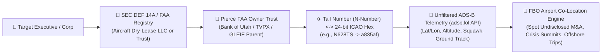

# Module 3: Physical, Geotemporal, Aviation, Maritime & Supply-Chain OSINT

> **Tradecraft Lineage:** NGA Activity-Based Intelligence (ABI), Bellingcat Geolocation & Maritime Teams, Hedge Fund M&A Jet Trackers (Quiver Quantitative / JetTrack), Windward / TankerTrackers Maritime Sanctions Intelligence, Muddy Waters Supply-Chain Verification.

---

## 1. Corporate Aviation & Executive Jet Intelligence (ADS-B Forensics)

Public executives, oligarchs, VC partners, and distressed-company CEOs frequently travel via private aviation. Even when they enroll their tail numbers in the FAA's **LADD (Limiting Aircraft Data Displayed)** or **PIA (Privacy ICAO Address)** programs to hide from FlightAware and FlightRadar24, the aircraft's Mode-S transponder physically broadcasts unencrypted **1090 MHz ADS-B / 978 MHz UAT** radio frames picked up by community SDR (Software-Defined Radio) networks like **`adsb.lol`** and **`OpenSky Network`**.

### 1.1 Resolving Corporate Jets When Hidden Behind Owner Trusts
1. **SEC `DEF 14A` & `10-K` Exhibit Footnotes:**
   * Public companies must disclose "perquisites" (perks) in the `DEF 14A` Executive Compensation table, often noting reimbursement to a private aircraft management LLC owned by the CEO (e.g., *"Paid $1.4M to [Executive Initials] Aviation LLC for business charter"*).
2. **Piercing Non-Citizen & Privacy Aircraft Trusts:**
   * Over 60% of high-value U.S. private jets (`N-Numbers`) are registered to **Owner Trustees** like **Bank of Utah Trustee**, **TVPX Aircraft Solutions**, **Wilmington Trust**, or **Wells Fargo Trust** so the true owner's name doesn't appear on the main FAA lookup line.
   * **How Investigators Pierce the Trust:**
     * **Method A (GLEIF Level-2 Parent Lookup):** If registered to a single-asset Delaware SPV (e.g., *G650 Holdings 442 LLC*), query the **GLEIF REST API** (`https://api.gleif.org/api/v1/lei-records`) for `direct-parent` and `ultimate-parent` relationships.
     * **Method B (FAA Deregistration / Export / Lien Trail & Radio Station License):** FCC Part 87 Aircraft Radio Station Licenses and state UCC-1 aircraft chassis (`serial_number` / `MSN`) security filings frequently name the **actual corporate guarantor or operating lessee** alongside the trustee!
3. **Deterministic Algorithmic Conversion (`N-Number` $\leftrightarrow$ `ICAO 24-bit Hex`):**
   * For U.S. `N-Numbers`, the ICAO 24-bit hex address (`a00001` through `adf7c7`) is a **pure mathematical bijection** of the tail number—meaning Bunnyhole can convert `N123AB` $\leftrightarrow$ `ICAO Hex` locally in Python without any external API lookup!

### 1.2 Live & Historical Unfiltered Flight Tracking (`adsb.lol` Keyless API)
 Bunnyhole integrates directly with the open, unfiltered **`adsb.lol` v2 API**:
* **By Registration (Tail Number):** `GET https://api.adsb.lol/v2/reg/{tail_number}`
* **By ICAO 24-bit Hex:** `GET https://api.adsb.lol/v2/hex/{icao_hex}`
* **By Point / Radius (FBO Airport Surveillance):** `GET https://api.adsb.lol/v2/point/{lat}/{lon}/{radius_nm}`

### 1.3 M&A & Crisis "FBO Co-Location" Anomaly Math
Hedge funds made hundreds of millions tracking Occidental Petroleum's jet landing in Omaha (Warren Buffett's home airport) before the Anadarko buyout announcement. Bunnyhole formalizes **FBO Co-Location Detection**:
* Given Target Aircraft $A$ and Peer/Acquirer/Regulator Aircraft $B$:
* A **Touchdown Event** is recorded when `alt_baro == "ground"` or `alt_baro < 500 ft` with `gs < 40 knots` within $3\text{ NM}$ of an airport coordinate $(x_{\text{apt}}, y_{\text{apt}})$.
* If Aircraft $A$ and Aircraft $B$ have overlapping ground windows $[t_{A,\text{in}}, t_{A,\text{out}}] \cap [t_{B,\text{in}}, t_{B,\text{out}}] \ge 90\text{ minutes}$ at a **non-hub regional/FBO airport** (e.g., Teterboro `KTEB`, Sun Valley `KSUN`, Farnborough `EGLF`, Bentonville `KVBT`, Omaha `KOMA`, Nassau `MYNN`, Grand Cayman `MWCR`), Bunnyhole raises a `HIGH_SIGNAL_RENDEZVOUS` event!

---

## 2. Maritime AIS, "Shadow Fleet" & Sanctions Evasion Forensics

When investigating sanctioned commodities (Russian/Iranian/Venezuelan crude), illicit weapons shipments, oligarch superyachts, or environmental dumping, actors manipulate maritime transponders.

### 2.1 Permanent Hull Identity (`IMO`) vs. Mutable Radio Identity (`MMSI`)
* **IMO Number (Strong Selector):** A 7-digit number (`IMO 9123456`) welded onto the ship's hull and engine room bulkhead at construction. **It never changes**—even if the ship changes owners 12 times, repaints its name, and re-flags from Panama to Gabon to Cameroon.
* **MMSI (Maritime Mobile Service Identity — 9 digits):** Broadcast over VHF AIS. The first 3 digits are the **MID (Maritime Identification Digits)** indicating the current flag state (e.g., `351–357` = Panama, `636` = Liberia, `538` = Marshall Islands, `626` = Gabon, `613` = Cameroon).
* **Flag-Hopping Velocity Flag:** If a vessel's MMSI prefix changes $\ge 3$ times in 24 months or shifts into known shadow-fleet convenience registries (Gabon, Cameroon, Eswatini, Palau, Comoros) while its P&I insurance drops off the International Group of P&I Clubs, Bunnyhole assigns a `SHADOW_FLEET_HIGH_RISK` score.

### 2.2 Detecting AIS "Going Dark", Spoofing & Ship-to-Ship (STS) Transfers
1. **Kinematic Impossibility (AIS Location Spoofing / "Circle Spoofing"):**
   * If consecutive AIS position reports $(t_1, \text{lat}_1, \text{lon}_1)$ and $(t_2, \text{lat}_2, \text{lon}_2)$ require an implied speed over ground:
     $$v_{\text{implied}} = \frac{\text{Haversine}(\text{pos}_1, \text{pos}_2)}{t_2 - t_1} > 35\text{ knots}$$
     (for a commercial tanker whose max speed is $15\text{ knots}$), the vessel is actively broadcasting **GNSS/AIS spoofed coordinates** while physically located elsewhere!
2. **Intentional AIS Dark Gap ("Going Dark"):**
   * An AIS transmission gap $\Delta t > 6\text{ hours}$ in high-coverage coastal/transshipment waters (Laconian Gulf Greece, Ceuta, Khor Fakkan, Riau Archipelago east of Singapore) where the vessel's **Draft (`draught` in meters)** changes between pre-gap ($d_1 = 14.8\text{m}$, fully laden) and post-gap ($d_2 = 8.2\text{m}$, ballast/empty) proves the ship **offloaded cargo while dark**!
3. **Ship-to-Ship (STS) Loitering Encounter Geometry:**
   * Two tankers $V_1, V_2$ satisfy an **STS Transfer Signature** when:
     $$\text{Distance}(V_1(t), V_2(t)) < 250\text{ meters}, \quad \text{SOG}_{V_1}, \text{SOG}_{V_2} < 2.5\text{ knots}, \quad |\text{COG}_{V_1} - \text{COG}_{V_2}| < 15^\circ$$
     sustained for $\Delta t \ge 3\text{ hours}$ outside an established port berth, paired with opposite draft deltas ($\Delta d_{V_1} < 0, \Delta d_{V_2} > 0$).

---

## 3. Supply-Chain, Bills of Lading & Trade-Based Money Laundering (TBML)

Activist short-sellers (Muddy Waters, Hindenburg) and FinCEN investigators routinely compare what a company *claims* in its SEC filings against physical **U.S. Customs & Border Protection (CBP) Vessel Automated Manifest System (AMS) Bills of Lading** (accessible via public trade aggregators like **ImportYeti**, **UN Comtrade**, and open maritime manifests).

### 3.1 The 3 Classic Trade-Forensic Red Flags
1. **Phantom Revenue / Ghost Supplier Trap:**
   * Company X claims \$300M in hardware/consumer goods sales in the U.S. manufactured by its overseas factory in Shenzhen or Vietnam.
   * Querying Bills of Lading for Company X and its `Exhibit 21` subsidiaries shows **zero TEU container shipments** or shipments totaling $< 10\text{ metric tons}$ for the entire fiscal year.
2. **Undisclosed Related-Party Supplier:**
   * Bills of Lading list the `Shipper / Exporter` overseas address. Cross-referencing that exporter's name and address against the CEO's family members or offshore registries reveals the CEO secretly owns the "independent" supplier and is marking up COGS to siphon cash out of the public company.
3. **Trade-Based Money Laundering (TBML) Unit-Price Anomaly:**
   * Comparing declared customs value ($V$) against gross weight ($W$ in kg) under a 6-digit **HS (Harmonized System) Code**. If the declared $/kg deviates by $> 4\sigma$ from the global HS-code median, it flags **Over-/Under-Invoicing TBML** (moving illicit value across borders disguised as commercial trade payments).

---

## 4. Bellingcat Geolocation & Solar Shadow Chronolocation

When an investigation hinges on verifying *where* and *when* a leaked photo or video was taken:
1. **Overpass Turbo (OpenStreetMap Spatial Constraint Solver):**
   * Translates visual landmarks in an image (e.g., *"a 4-lane highway running North-South, a mosque or church within 150m to the East, and high-voltage power lines crossing within 100m"*) into an **Overpass QL** query against OpenStreetMap to return the exact candidate $(lat, lon)$ coordinates on Earth.
2. **Solar Azimuth & Shadow Trigonometry (SunCalc Chronolocation):**
   * Given an object of height $H$ casting a shadow of length $L$ at horizontal compass bearing $\alpha_{\text{shadow}}$:
     * **Solar Azimuth:** $\alpha_{\text{sun}} = (\alpha_{\text{shadow}} + 180^\circ) \bmod 360^\circ$
     * **Solar Altitude Angle:** $\theta_{\text{alt}} = \arctan\left(\frac{H}{L}\right)$
   * Solving the astronomical solar position equations for $(\text{lat}, \text{lon}, \text{date})$ pinpoints the **exact UTC timestamp** the photograph was captured—catching faked alibis or backdated inspection photos!
