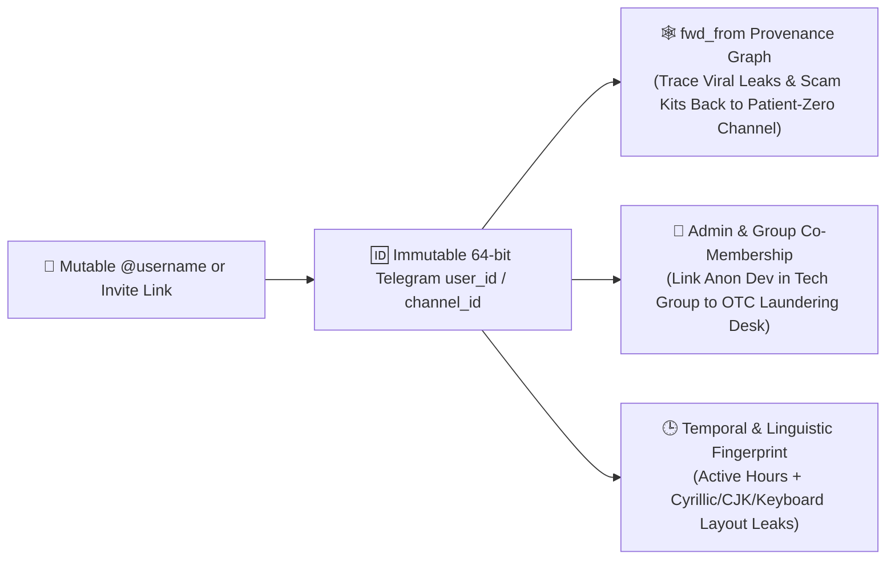

# Module 4: Breach Intelligence, Telegram Graph Recon, Dark-Web & Leak Correlation

> **Tradecraft Lineage:** Mandiant / CrowdStrike Cyber Crime Intelligence, Hudson Rock Infostealer Forensics, Bellingcat Telegram Investigation Team, Ransomware.live / Ransomlook Extortion Tracking.

---

## 1. Telegram OSINT & Forwarding Graph Forensics

Telegram is the operational command center for crypto drainers, OTC laundering brokers (such as Huione-style guarantee markets), hacktivist collectives, and insider pump groups. While actors believe changing their `@username` makes them untraceable, Telegram's underlying **MTProto architecture** leaks permanent structural identifiers.

### 1.1 Immutable `user_id` / `channel_id` vs. Mutable `@username`
* Every Telegram user, group, and channel is assigned a permanent integer **`id` (`peer_id`)** at account creation:
  * **User ID Range Estimation:** Because Telegram allocates `user_id` sequentially, the numeric magnitude of a `user_id` reveals the **approximate month and year the account was registered** (e.g., IDs `< 100,000,000` date to 2013–2015; IDs around `1,000,000,000` date to ~2019; IDs `> 6,500,000,000` are newly minted 2024–2026 burner accounts!).
  * **The Burner Detection Signal:** When a "long-time protocol founder" communicates from a Telegram account with `user_id > 7,000,000,000`, Bunnyhole immediately flags a **Newly Minted Burner Identity**.

### 1.2 Reconstructing the `fwd_from` Information Propagation Graph
When messages are forwarded across Telegram channels or groups, the message object preserves a `fwd_from` (`MessageFwdHeader`) struct containing:
* `from_id`: The original `PeerChannel(channel_id=...)` or `PeerUser(user_id=...)` that authored the post.
* `from_name`: If the original user enabled privacy settings to hide their link on forwards, `from_name` still records their **exact display name at the moment of the forward**.
* `date`: The original UTC timestamp of the source message.
* `channel_post`: The message ID inside the origin channel.

**How Bunnyhole Uses This:**
By building a directed NetworkX graph where edges $(C_{\text{origin}} \xrightarrow{\text{fwd}} C_{\text{amplifier}})$ are weighted by forward frequency and minimum latency $\Delta t = t_{\text{fwd}} - t_{\text{origin}}$, Bunnyhole identifies:
1. **Patient Zero Channels:** The small, private or semi-private channel where a leaked document, exploit PoC, or coordinated smear campaign first appeared before larger aggregator channels amplified it.
2. **Coordinated Sockpuppet Amplifiers:** Clusters of channels that forward messages from the same source within $\Delta t < 30\text{ seconds}$ (proving automated botnet cross-posting controlled by one admin).

---

## 2. Infostealer & Breach Metadata Correlation (Hudson Rock Cavalier + HIBP + Holehe)

When investigating a corporate insider, a rogue developer, or a breached company, one of the highest-signal modern OSINT sources is **Infostealer Telemetry** (machines compromised by malware families like RedLine, Lumma, Raccoon, Vidar, or MetaStealer when users download cracked software, fake game mods, or malicious npm/PyPI packages).

### 2.1 Zero-Key Infostealer OSINT via Hudson Rock's Free Cavalier API
Bunnyhole integrates with **Hudson Rock's public Cavalier OSINT endpoints** (`https://cavalier.hudsonrock.com/api/json/v2/osint-tools/`), which return redacted, ethical forensic metadata without exposing raw plaintext passwords:
* **By Email:** `GET /search-by-email?email={email}`
* **By Username:** `GET /search-by-username?username={username}`
* **By Domain:** `GET /search-by-domain?domain={domain}`
* **By IP Address:** `GET /search-by-ip?ip={ip}`

**What This Reveals in an Investigation:**
* `date_compromised`: Exact timestamp the target's computer was infected.
* `computer_name` & `operating_system`: Often leaks the person's real first name or corporate asset tag (e.g., `DESKTOP-ALEX-MACBOOK` or `ACME-CORP-LT04`).
* `ip` & `country`: The real residential or office IP address and country of the target at the moment of infection (bypassing any VPN they normally use on specific websites!).
* `stealer_family`: Confirms whether a company claiming "no customer credentials were leaked" actually has dozens of employee machines with compromised corporate SSO sessions.

### 2.2 Non-Alerting Account Enumeration (`holehe` + Gravatar MD5 + GitHub + Keybase)
Given an email address `target@domain.com`:
1. **Gravatar MD5 Hash Pivot:**
   * Computes `md5(email.strip().lower())` and queries `https://en.gravatar.com/{md5_hash}.json`.
   * Many targets who scrubbed their current social profiles forgot they created a Gravatar/WordPress profile 8 years ago—which returns their `preferredUsername`, `displayName`, `thumbnailUrl` (avatar image), and verified accounts!
2. **`holehe` Registration Oracle Sweep:**
   * Checks 120+ services (Twitter/X, Instagram, Spotify, Adobe, Gravatar, Wordpress, Proton, etc.) to build a behavioral lifestyle & tech-stack profile of the target without sending a single email alert.

---

## 3. Ransomware Leak Indexes & Undisclosed Corporate Breach Hunting

Public and private companies frequently suffer catastrophic ransomware attacks or data exfiltration while telling investors and journalists they are experiencing a *"temporary scheduled system maintenance outage."*

### 3.1 Querying Live Ransomware Extortion Feeds (`Ransomware.live` / `Ransomlook` Public APIs)
Bunnyhole queries public, dark-web-indexed ransomware extortion APIs (such as `https://api.ransomware.live/v2/search/{company}`):
* Cross-checks every target `Organization` and its `Exhibit 21` subsidiaries against posts from 100+ known ransomware groups (LockBit, ALPHV/BlackCat, Cl0p, Akira, Play, RansomHub, Qilin).
* Extracts:
  * **Discovery Date vs. Public Disclosure Date:** Highlights if executives dumped stock on **SEC Form 4** *after* the ransomware group posted them on a Tor leak site, but *before* the company filed an **SEC Form 8-K Item 1.05 (Material Cybersecurity Incidents)**!
  * **Exfiltrated Data Summary & Proof Screenshots:** Links the extortion metadata directly as an `EvidenceReceipt` on the corporate node.

---

## 4. URLScan.io & Historical DOM/Certificate Pivot Hunting

When investigating ephemeral phishing kits, scam frontends, or vanished corporate landing pages that blocked the Wayback Machine via `robots.txt`:
* **URLScan.io Public Search API (`https://urlscan.io/api/v1/search/`):**
  * Security researchers and automated sandboxes submit millions of URLs daily to URLScan.io, which records the **full rendered DOM, all HTTP requests made by the page, every IP/ASN contacted, the TLS certificate hash, and a full-page screenshot**—and **ignores `robots.txt` archival blocks**!
  * Bunnyhole queries:
    * `page.domain:{domain}` (finds historical scans of deleted sites)
    * `files.sha256:{asset_hash}` (finds every other domain on the internet loading the exact same logo, JS bundle, or drainer script!)
    * `page.ip:{ip}` (finds sibling domains hosted on the same non-CDN IP).
