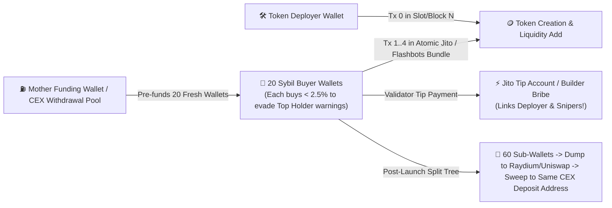
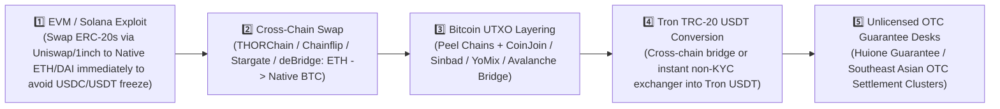

# Module 5: Advanced DeFi, MEV, Insider Bundlers & Mixer/Cross-Chain De-Obfuscation

> **Tradecraft Lineage:** ZachXBT On-Chain Investigations, TRM Labs / Chainalysis Lazarus Group Tracking, Bubblemaps Supply Clustering, Academic Zero-Knowledge Mixer De-Anonymization (Tutela / Wu et al. / Béres et al.).

---

## 1. Solana & EVM Insider Token Launches: Block-0 Bundlers & Supply Split-Trees

When insider cabals launch memecoins or governance tokens (on **Pump.fun**, **Raydium**, **Uniswap v2/v3**, or **Aerodrome**), they want retail traders to believe the token is "fairly distributed" while secretly controlling $65\%–85\%$ of the circulating supply across 30+ seemingly independent wallets.

### 1.1 Detecting Atomic Jito Bundles (Solana) & Flashbots Bundles (EVM)
1. **The Block-0 / Slot-0 Atomic Signature:**
   * On Solana, public users cannot see a token creation transaction and submit a reaction buy within the **exact same 400ms slot (`slot_delta == 0`)** unless those transactions were submitted together inside a **Jito MEV Bundle** (which groups up to 5 transactions atomically).
   * **Detection Rule:** Bunnyhole pulls all transactions in `creation_slot` (or `creation_block` on EVM) and inspects `tx_index`. Any buyer executing in `slot_delta == 0` (or `block_delta == 0` immediately following the `addLiquidity` transaction index) is flagged as an **`ATOMIC_BUNDLE_INSIDER`**.
2. **Tracing the Jito Validator Tip / Builder Bribe:**
   * Every Jito bundle includes a transfer to one of the 8 canonical **Jito Tip Payment Accounts** (e.g., `96gYZGLnJYVFmbjzopPSU6QiEV5fGqZNyN9nmNhvrZU5`, `HFqU5x63VTqvQss8hp11i4wVV8bD44PvwucfZ2bU7gRe`).
   * Often, the deployer's wallet pays the Jito tip for the entire bundle of "independent" buyer wallets—or all bundled wallets pay the exact same non-round lamport tip (`e.g., 14,250,000 lamports`), proving single-script orchestration!
3. **Bubblemaps-Style Supply Split-Tree Detection:**
   * After sniping $60\%$ of supply across 10 wallets, insiders run a **Fan-Out Split Script** where each sniper wallet sends $1.2\%$ of the token supply to 5 fresh wallets (`Depth-2 Sybils`) so no wallet appears in the Top 10 Holders list.
   * **Graph Algorithm:** Bunnyhole constructs the directed **Token Transfer Subgraph** $G_{\text{token}} = (V, E_{\text{transfer}})$ for the first 24 hours of a token's life. Any connected component (excluding the AMM Liquidity Pool contract itself) whose combined current balance exceeds $5\%$ of total supply is collapsed into a single **`INSIDER_SUPPLY_CLUSTER`** node!

---

## 2. De-Anonymizing Privacy Mixers (Tornado Cash / Railgun Heuristics)

While zero-knowledge mixers use Pedersen commitments and zk-SNARKs to sever the deterministic on-chain link between a deposit and a withdrawal, human operators and automated laundering scripts leak **4 statistical & behavioral side-channels**:

### 2.1 Heuristic A: Exact Multi-Note Denomination Vector Matching
Tornado Cash uses fixed-denomination pools: $D = \{0.1, 1, 10, 100\}\text{ ETH}$ (or $\{100, 1000, 10000, 100000\}\text{ DAI/USDC}$).
* Suppose an exploiter steals $432\text{ ETH}$ and deposits it into Tornado Cash from address $A_{\text{dep}}$ over a 45-minute window as a specific **Denomination Vector**:
  $$\vec{v}_{\text{dep}} = (n_{100}=4, \; n_{10}=3, \; n_{1}=2, \; n_{0.1}=0)$$
* If, $\Delta t \in [2\text{h}, 72\text{h}]$ later, a fresh address (or cluster of addresses that later converge) withdraws the exact vector $\vec{v}_{\text{wdr}} = (4, 3, 2, 0)$ within a compact time burst $\delta t_{\text{burst}} < 3\text{ hours}$:
* Bunnyhole calculates the Poisson background rate $\lambda_d$ of each pool during $\Delta t$ and computes the **Combinatorial Likelihood Ratio** (`Confidence 0.75–0.94`, `Admiralty B2`).

### 2.2 Heuristic B: Gas-Price, Relayer & Time-of-Day Fingerprinting
* **The Pre-Funded Gas Mistake:** If the withdrawal address $A_{\text{wdr}}$ did *not* use a Tornado Cash Relayer, it had to already possess ETH to pay for the `withdraw()` transaction gas! Tracing $A_{\text{wdr}}$'s first-funder (`tx_index == 0`) frequently leads right back to the depositor's Mother Wallet or CEX account (`Admiralty A1`).
* **Waking-Hour Intersection:** An actor who makes 14 deposits exclusively between `01:00–09:00 UTC` (e.g., `UTC+8` daytime) and executes 14 withdrawals exclusively between `01:00–09:00 UTC` narrows the candidate anonymity set by $>65\%$.

### 2.3 Heuristic C: Post-Mix Liquidity & Token Re-Convergence
* When an actor withdraws from a mixer into 5 separate fresh wallets $W_1 \dots W_5$ to look independent, they almost always **re-converge** within 1–3 hops by:
  1. Sending all 5 balances into the **same CEX Deposit Sweep Address** or the **same THORChain/bridge destination address**.
  2. Buying the exact same low-cap token or providing liquidity to the same pool within minutes of each other.
  3. Approving or funding the same multisig (`Safe`).

---

## 3. Lazarus Group & Syndicate Cross-Chain Laundering Typology

State-sponsored hackers (DPRK Lazarus Group / TraderTraitor) and major drainer syndicates follow a highly structured 5-stage cross-chain pipeline that Bunnyhole's `OnChainAgent` is explicitly programmed to trace:

### How Bunnyhole Tracks Across the Chain Hop (`ETH` $\rightarrow$ `BTC` $\rightarrow$ `TRON`)
1. **Stage 1 $\rightarrow$ 2 (EVM to Native Bitcoin via THORChain / Chainflip):**
   * When an EVM wallet sends ETH/ERC-20 to a **THORChain Router** (`depositWithExpiry`), the transaction calldata `memo` field **literally contains the destination Bitcoin address in plaintext** (e.g., `=:BTC.BTC:bc1qxyz123...:0/1/0:t:0`)!
   * Bunnyhole decodes the EVM calldata hex into UTF-8 ASCII, extracts the destination `bc1q...` Bitcoin address deterministically (`Admiralty=A1`, `Confidence=1.00`), and automatically hands that Bitcoin address to the **Bitcoin UTXO Forensics Engine** (`Mempool.space` connector)!
2. **Stage 2 $\rightarrow$ 3 (Following the Bitcoin Peel Chain):**
   * Bunnyhole applies the **Common Input Ownership Heuristic (CIOH)** and **Peel Chain Change Detection** on the extracted `bc1q...` address, walking forward along the $80\%+$ change outputs until the funds hit an exchange or cross-chain bridge deposit address.
