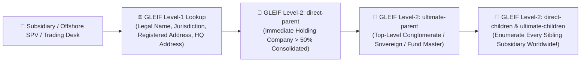

# Module 6: Global Offshore Leaks, GLEIF Corporate Trees, UK PSC Beneficial Owners & UCC-1 Debt Forensics

> **Tradecraft Lineage:** ICIJ (Panama/Pandora/Paradise Papers), OCCRP Aleph, Global Legal Entity Identifier Foundation (GLEIF), Hindenburg Research Debt & Lien Forensics.

---

## 1. Global Corporate Hierarchy Mapping via the Zero-Key GLEIF API

While SEC EDGAR covers U.S.-listed corporations, international hedge funds, trading desks, offshore SPVs, aircraft trusts, and European/Asian conglomerates are required by global financial regulations (MiFID II, EMIR, Dodd-Frank) to obtain a **20-character Legal Entity Identifier (LEI)**.

### 1.1 How Bunnyhole Exploits GLEIF Level-1 & Level-2 ("Who Owns Whom") Data
The **GLEIF REST API v1 (`https://api.gleif.org/api/v1/lei-records`)** is **100% free, requires zero API key**, and exposes both entity details (Level 1) and parent/child ownership relationships (Level 2):
1. **Fuzzy Name & Jurisdiction Search:**
   `GET https://api.gleif.org/api/v1/lei-records?filter[entity.legalName]={company_name}`
2. **Walking Up the Ownership Chain (`direct-parent` & `ultimate-parent`):**
   * `GET /api/v1/lei-records/{lei}/direct-parent`
   * `GET /api/v1/lei-records/{lei}/ultimate-parent`
   * Even if a parent entity does not have an LEI, GLEIF provides `parent-relationship-exceptions` explaining *why* (e.g., `NATURAL_PERSONS` — confirming the company is directly owned by private individuals rather than a parent corporation, or `NON_CONSOLIDATING` — confirming an offshore investment fund/trust structure!).
3. **Walking Down the Ownership Tree (`direct-children` & `ultimate-children`):**
   * `GET /api/v1/lei-records/{lei}/ultimate-children`
   * Instantly enumerates every registered trading vehicle, Cayman feeder fund, Luxembourg SARL, or Delaware LLC consolidated under that parent across 200+ jurisdictions.

---

## 2. ICIJ Offshore Leaks & Cross-Border Secrecy Jurisdictions

The **International Consortium of Investigative Journalists (ICIJ)** published structured graph data from five massive offshore leaks totaling **810,000+ offshore companies, trusts, and foundations** across Panama, the British Virgin Islands (BVI), Cayman Islands, Bahamas, Samoa, Seychelles, Bermuda, Mauritius, and Cyprus:
1. **Pandora Papers** (14 offshore service providers including Alcogal, Trident Trust, Asiaciti)
2. **Paradise Papers** (Appleby corporate registry & 19 tax haven registries)
3. **Panama Papers** (Mossack Fonseca)
4. **Bahamas Leaks** & **Offshore Leaks**

### 2.1 The 4 ICIJ Node Archetypes & How Bunnyhole Matches Them
* **`Entity`:** The offshore shell company, trust, or foundation (`jurisdiction`, `incorporation_date`, `inactivation_date`, `struck_off_date`, `service_provider`).
* **`Officer`:** The individual or corporate nominee holding a role (`Shareholder`, `Beneficial Owner`, `Director`, `Protector of Trust`, `Authorized Signatory`, `Nominee Director`).
* **`Intermediary`:** The law firm, wealth manager, or family office that ordered the creation of the offshore shell (often the smoking gun linking a Western law firm to a sanctioned oligarch or crypto founder).
* **`Address`:** Physical residential or office addresses leaked from the law firm's internal KYC files (which unlike public registries show the **beneficial owner's real home address**!).

---

## 3. UK Companies House & "Persons with Significant Control" (PSC)

The United Kingdom (England, Wales, Scotland, Northern Ireland) is one of the world's most heavily used jurisdictions for cross-border corporate layering (`UK Ltd` and `UK LLP`). Unlike Delaware or Wyoming (which hide beneficial owners from public search), the UK mandates a public **Persons with Significant Control (PSC) Register**:

### 3.1 What the PSC Register Exposes
Any individual who directly or indirectly holds **$>25\%$ of shares or voting rights**, or has the right to appoint/remove a majority of the board, must be listed with:
* **Full Legal Name & Title**
* **Month and Year of Birth** (e.g., `1988-04` — a massive **Soft-to-Strong Selector upgrade** that lets Bunnyhole disambiguate common names across global records!)
* **Nationality & Country of Usual Residence**
* **Nature of Control** (e.g., `ownership-of-shares-75-to-100-percent`)
* **Correspondence / Service Address**

### 3.2 Catching "Scottish Limited Partnerships" (SLPs) & Dormant Filings
* Bunnyhole flags **Dormant Company Accounts (`Form AA02`)** paired with high on-chain or trade volume, frequent registered office changes, and corporate PSCs domiciled in opaque non-PSC jurisdictions (BVI/Belize/Marshall Islands).

---

## 4. State UCC-1 Liens, Factoring & "Merchant Cash Advance" (MCA) Distress Forensics

How did forensic short-sellers like Hindenburg Research prove that publicly traded or high-flying private companies were secretly weeks away from insolvency while touting "strong balance sheets"? **By searching UCC-1 (Uniform Commercial Code) Financing Statements and state litigation dockets.**

### 4.1 The UCC-1 & MCA "Death Spiral" Indicator
1. **What a UCC-1 Filing Shows:**
   * **Debtor:** The target company (and often the founder personally guaranteeing the debt) + exact street address.
   * **Secured Party (Lender):** The bank, private credit fund, equipment lessor, or **Merchant Cash Advance (MCA) / Factoring shark**.
   * **Collateral Description:** Specifies whether the company has pledged *"All Assets"*, *"All Accounts Receivable"*, specific factory machinery serial numbers, or corporate aircraft tail numbers (`MSN` / `N-Number`).
2. **The Predatory MCA Red Flag:**
   * Legitimate solvent corporations borrow from commercial banks or issue bonds at $6\%–10\%$ APR.
   * When a company is secretly out of cash and cut off by banks, desperate insiders take out **Merchant Cash Advances (MCAs)**—loan-shark-style daily/weekly revenue sweeps at $40\%–150\%$ effective APR—whose lenders immediately file UCC-1 liens (or New York Supreme Court "Confessions of Judgment" / collection lawsuits) via anonymous-sounding names like *CT Corporation System, as representative* or known MCA lenders.
   * **Bunnyhole Rule:** Any corporate target showing active UCC-1 liens from high-cost factoring/MCA lenders or multiple overlapping pledges on identical receivables receives a `CRITICAL_LIQUIDITY_DISTRESS` flag.
